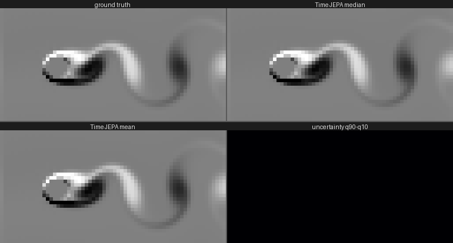
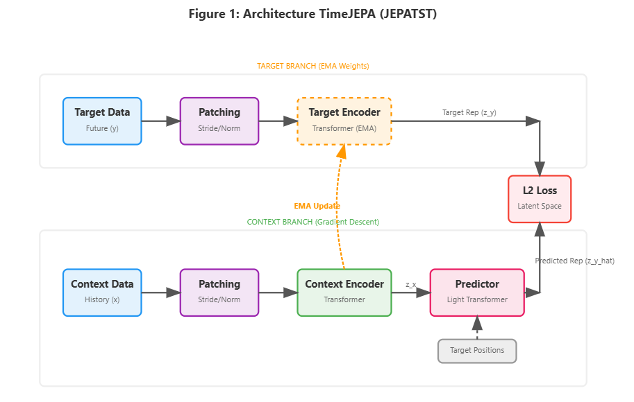

# TimeJEPA: Joint-Embedding Predictive Architectures for Time Series

TimeJEPA asks one question: can a Joint Embedding Predictive Architecture,
trained as an energy-based model on time series, learn representations of the
future that are coherent enough to tell plausible futures from implausible
ones? The answer, measured on frozen checkpoints, is yes. The same weights,
finetuned with a quantile head on top, give a small zero-shot forecaster
evaluated on all 97 GIFT-Eval configurations.

Everything was trained on three RTX 3090s by one person. Every number traces
to a dated entry in an experiment log where predictions were written down
before the runs (see the end of this page).

## TimeJEPA-EBM: the latent as judge

A pretrained JEPA is implicitly an energy over (context, future) pairs:

    E(x, y) = 1 - cos(pred(enc(x)), enc(y))

The encoder embeds the context, the predictor produces the embedding of the
future, and the pretraining objective lowers E on true pairs. Nothing below
trains anything further: the checkpoints are read frozen.


**The judge exists, and finetuning destroys it.** The probe presents each
checkpoint with 34 candidate futures for a context (32 block bootstraps of the
past, the seasonal naive, and the truth) and reads the normalized rank of the
truth under E. Chance is 0.50.

| Checkpoint | Rank of the true future |
|---|---|
| chance | 0.500 |
| TimeJEPA-EBM (1.1M, pretrained only) | 0.219 |
| the same weights after finetuning as a forecaster | 0.349 |

The energy follows the real distance to the truth (correlation with the MAE of
each candidate 0.35 on the released judge, 0.62 to 0.77 on earlier ones), on
every dataset probed, including those the forecaster gets wrong. The judge
peaks early in pretraining and erodes while the validation loss keeps
improving; finetuning the same weights into a forecaster degrades it from
0.219 to 0.349.

**What the judge knows.** On a controlled simulator with a known arrow of
time, the energy separates a future from its time reversal with an AUC of
0.808 and reacts to out-of-range actions at 0.935. It does not carry
continuity between context and future: a future teleported to another level
is accepted (AUC 0.556, chance). The energy is a classifier of futures, not a
regularizer: used as a penalty inside a planner it does not reduce
constraint violations.

**A zero-training reranker.** Given a proposer, the judge turns a pool of
candidate futures into weighted quantiles. With TTM-R3 as proposer, on the
six Nixtla long-horizon datasets, weighted quantile loss as a ratio to the
seasonal naive:

| | ettm1 | ettm2 | etth1 | etth2 | weather | exchange |
|---|---|---|---|---|---|---|
| TTM-R3 alone | 0.88 | 0.81 | 0.85 | 0.95 | **0.63** | 0.88 |
| TTM-R3 + frozen judge | **0.77** | **0.72** | **0.71** | **0.78** | 0.64 | **0.78** |

Six of six beaten or tied, replicated with judges from two pretraining
lineages. On the 97 GIFT-Eval configurations (150 instances each, paired
windows), the reranked fan takes 5.3 CRPS points off TTM's collapsed point
forecast (0.7258 to 0.6732) for a 3.8 % MASE cost; the 3.4M judge (the standard mini pretrain) brings the
CRPS to 0.6508. Given a deliberately biased proposer, the judge moves its
mass to the alternative center kept in the pool: a verifier that can fire its
proposer. Coverage (0.62 against 0.80 nominal) is the open gap.

**What did not work**, recorded with the same care: selecting the resampling
rate by energy is worse than selecting it by backtest; reweighting the
forecaster's own calibrated fan with its judge dilutes it; refining
candidates by gradient descent on E helps only on uncentered pools; and the
forecaster and the judge are two checkpoints, not one.

## TimeJEPA-forecast



The forecaster is the pretrained JEPA, finetuned for one epoch on the same
corpus with a quantile head on top (cross-attention over the context and an
MLP, nine quantiles that cannot cross), and evaluated zero-shot on GIFT-Eval
with no per-dataset adaptation. The animation is the 1.14M-parameter
checkpoint forecasting a fluid simulation it has never seen, every pixel as an
independent series: the red frame marks the end of the context, and the fan
width in the third panel is the model's own uncertainty (empirical 80 %
coverage on this scene: 0.79).

GIFT-Eval, 97 configurations, geometric means of the ratio to the official
seasonal naive, lower is better.

| Model | Parameters | Inference | MASE | CRPS | 80 % coverage |
|---|---|---|---|---|---|
| TimeJEPA-mini | 3.9M | sign flip + test-time backtest resampling | **0.7842** | **0.5340** | 0.756 |
| TimeJEPA-mini | 3.9M | sign flip | 0.8543 | 0.5842 | 0.781 |
| TimeJEPA-mini | 3.9M | none | 0.8877 | 0.6131 | 0.740 |
| TimeJEPA-tiny | 1.14M | sign flip + test-time backtest resampling | 0.815 | 0.559 | |

Among the sub-10M models of the GIFT-Eval leaderboard, aggregated with the
same formula (parameter counts from the leaderboard metadata):

| Model | Parameters | CRPS ratio |
|---|---|---|
| FlowState 9.1M | 9.1M | 0.502 |
| TTM-R3 | 1.4M | 0.520 |
| Toto-2.0-4m | 4.1M | 0.524 |
| TempoPFN | n/a | 0.533 |
| **TimeJEPA-mini** | **3.9M** | **0.534** |
| TinyCast | 0.1M | 0.545 |
| goia-forecast-nano | 4.7M | 0.553 |
| Kairos-10m | 9.9M | 0.554 |
| Metamorph-4.5M | n/a | 0.555 |
| **TimeJEPA-tiny** | **1.14M** | **0.559** |
| YingLong-6m | 7.3M | 0.609 |

## Usage

```python
import numpy as np
import torch
from pathlib import Path
from hydra import compose, initialize_config_dir

from timejepa.evaluation import create_model_from_config, load_checkpoint

with initialize_config_dir(config_dir=str(Path("configs/model").resolve()),
                           version_base=None):
    cfg = compose(config_name="lotsa_tiny_v3_eval")

model = create_model_from_config(cfg)
model = load_checkpoint(model, "checkpoints/<checkpoint>.ckpt",
                        torch.device("cpu")).eval()

history = np.asarray(my_series, dtype=np.float32)    # raw values, any scale
x = torch.from_numpy(history[-1024:])[None, :, None]

with torch.no_grad():
    out = model.forecast(x, n=192)                   # any horizon

median = out["forecast_denorm"][0, :, 0]             # [n]
fan = out["quantiles_denorm"][0]                     # [n, 9], levels 0.1 to 0.9
```

Normalization lives inside the model: feed raw values, read raw values back.
The quantile fan cannot cross by construction. Interpolate NaNs in the
context before calling. `scripts/evaluate_gift.py` is the reference
inference pipeline; sign-flip averaging and the test-time resampling live
there.

Checkpoints are not distributed yet. They will be published on Hugging Face
together with the preprint. Until then, the training commands below produce
one in about a day on three GPUs. The judge is read from a pretrain checkpoint
with `scripts/probe_energy.py` (rank probe) and `scripts/evaluate_energy.py`
(propose-judge-reweight).

## Setup

[uv](https://github.com/astral-sh/uv) manages the environment:

```bash
curl -LsSf https://astral.sh/uv/install.sh | sh
git clone https://github.com/IUseAMouse/TimeJEPA.git
cd TimeJEPA
make install
```

Evaluation data, the 97 GIFT-Eval configurations (a few GB):

```bash
make gift-download
```

Pretraining corpus: LOTSA plus a seeded synthetic generator, streamed and
converted once. Subsets overlapping any evaluation benchmark are excluded by
verified name patterns; the decontamination audit is in the experiment
registry.

```bash
python scripts/prepare_lotsa.py --out data/processed/lotsa
```

The TTM hybrid experiments need one extra dependency:

```bash
uv pip install -e ".[ttm]"
```

## Architecture



The model forecasts in embedding space. An encoder cuts the context into
patches of 16 steps and embeds them with a RoPE transformer. A predictor
reads those embeddings through learned queries, one query per future patch,
and produces the embeddings of the future. A quantile head decodes each of
them into nine quantiles: the median is regressed directly and the other
levels are stacked on top of it as positive widths, so the fan cannot cross.

Two normalizations let one checkpoint work at any scale: a robust arcsinh
compression that tames spikes, then a per-window standardization. Both are
inverted at the output.

During pretraining, the target embeddings come from a slow moving-average
copy of the encoder, and a variance regularizer keeps the embedding space
from collapsing. The forecaster is then finetuned for one epoch with a
pinball loss on the quantile fan.

## Training and evaluation

```bash
# Pretrain (lotsa_tiny_v3 is the current recipe)
python scripts/train.py --config-name lotsa_tiny_v3 wandb.run_name=my-run

# Finetune (one cosine epoch, every checkpoint kept)
python scripts/train.py --config-name lotsa_tiny_v3_zeroshot \
    '+training.pretrained_encoder_path="checkpoints/.../<ckpt>"'

# GIFT-Eval, 97 configs, under 15 minutes on one 3090
python scripts/evaluate_gift.py --config-name lotsa_tiny_v3_eval \
    '+checkpoint_path="checkpoints/.../<ckpt>"' +tta_flip=true +ratein=backtest

# Video demo: every pixel forecast as an independent series
python scripts/forecast_video.py
```

## Project structure

```text
src/timejepa/             # data, models, training, evaluation
scripts/                  # entry points: train, evaluate_gift, probes, demos
configs/model/            # one-variable config lineages
evaluation/               # per-config JSON results, cached
```

## Experiment log

Every run of this project, with its prediction written before launch, its
thresholds and its verdict, is recorded in a dated experiment log kept outside
the repository. I am glad to share it with anyone who wants to know what
happened during training, including what did not work: open an issue or write
to the address in the citation.

## Citation

Paper in preparation. Until the arXiv version lands:

```bibtex
@misc{vincent2026timejepa,
  author = {Vincent, Yvann},
  title  = {TimeJEPA: Small Joint-Embedding Foundation Forecasters},
  year   = {2026},
  url    = {https://github.com/IUseAMouse/TimeJEPA}
}
```

## License

[MIT](LICENSE)
