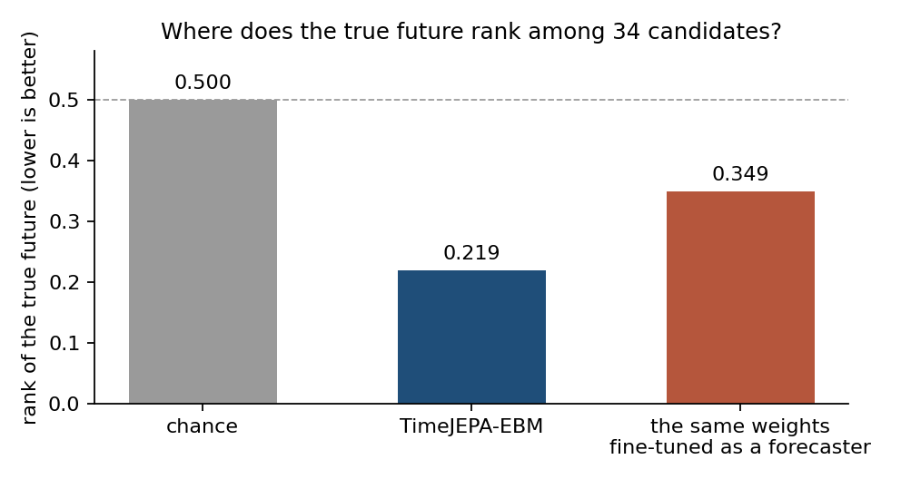

# TimeJEPA-EBM

<!-- 2026-10-12. One checkpoint: tiny v3, timejepa_lotsa_tiny_v3/pretrain_True/epoch01_valloss0.6420
     (1.1M). Numbers from other checkpoints are labelled with their lineage. -->

A Joint Embedding Predictive Architecture pretrained on 15.85 billion observations of
public time series and read as an energy-based model: given a context and a candidate
future, it returns a scalar energy, low when the future is plausible for that context.
It generates nothing. It judges.

It was trained by one person on three RTX 3090s, outside of any lab or company.

## What it is

The encoder embeds a window of a series, patch by patch; the predictor, from the
embeddings of a context, produces the embeddings of the patches that follow. Pretraining
pulls the predicted embeddings toward the embeddings of the true continuation. That
objective makes the frozen model an energy function over (context, future) pairs:

    E(x, y) = 1 - cos(pred(enc(x)), enc(y))

The candidate is encoded on its own, with the context's normalization statistics (the
training convention of these checkpoints), and compared with what the predictor
expected. Nothing is trained for the judging task: the released checkpoint is the
pretraining checkpoint, as saved: `epoch01_valloss0.6420`, 1.1M parameters, one epoch
of the corpus and the start of a second.

## What it does

Measured on frozen checkpoints, no downstream training.

**It ranks the true future above bootstrapped alternatives.** For a context, 34
candidate futures are built: 32 block bootstraps of the series' own past, the seasonal
naive, and the truth. The normalized rank of the truth under E, averaged over
instances, is 0.50 for a random judge.



| Checkpoint | Rank of the true future |
|---|---|
| chance | 0.500 |
| **TimeJEPA-EBM** | **0.219** |
| the same weights after finetuning as a forecaster | 0.349 |

On the released checkpoint (six GIFT-Eval configurations, 100 instances each, measured
on 2026-10-12) the truth lands in the top 20 % of the candidates 63 % of the time, and
the energy follows the distance to the truth (correlation with each candidate's mean
absolute error 0.35). The judge is strongest on
hourly electricity (rank 0.036) and weakest on 10-minute solar (0.477). Finetuning the
same weights into a forecaster degrades the judge to 0.349 (measured on the finetuned
checkpoint of the same run); the forecaster and the judge are two checkpoints.

**It turns a point forecaster into a probabilistic one, with no training.** The
proposer forecasts; its forecast is recentered and surrounded by bootstrapped seasonal
innovations into a pool of candidates; the judge scores the pool; the weighted
candidates are read out as quantiles.

| Proposer | Benchmark | Proposer alone | + TimeJEPA-EBM | Checkpoint |
|---|---|---|---|---|
| TTM-R3 | Nixtla long-horizon, weighted quantile loss vs seasonal naive, ettm1 / ettm2 / etth1 / etth2 / weather / exchange | 0.88 / 0.81 / 0.85 / 0.95 / 0.63 / 0.88 | **0.77 / 0.72 / 0.71 / 0.78 / 0.64 / 0.78** | released |
| TTM-R3 | GIFT-Eval, 97 configurations, 150 instances each, CRPS of the collapsed point forecast | 0.7258 | **0.6732** | released |

Six datasets of six beaten or tied on Nixtla, replicated with a judge from an earlier
pretraining lineage. On GIFT-Eval the gain is paid with a 3.8 % increase of the median's error (MASE) and the
80 % interval covers 0.62 of the outcomes against 0.80 nominal. These GIFT numbers are
paired comparisons on the same windows, not leaderboard numbers: the harness caps each
configuration at 150 instances and uses the local seasonal naive.

**It knows the arrow of time.** On a simulated thermostat with a known dynamics, the
energy separates a future from its time reversal with an AUC of 0.808, and an inverted
response to an action at 0.935 (tiny, mixed corpus, earlier lineage). Given a deliberately biased
proposer, the judge moves its mass to the alternative center kept in the pool: a verifier
that can fire its proposer.

## What it does not do

- **It is not a forecaster.** Read alone, with bootstrapped candidates and no proposer,
  a judge of an earlier lineage beats the seasonal naive on 5 of 6 Nixtla datasets and
  ties the finetuned forecaster on one. Its value is in judging someone else's proposals.
- **It does not see continuity.** A future shifted to another level, with the right
  shape, is accepted (AUC 0.556 against a time jump, chance level). Continuity has to be
  enforced outside the energy.
- **It is a classifier, not a regularizer.** Used as a penalty inside a planner, it does
  not reduce constraint violations.
- **It does not select the sampling rate.** Choosing the resampling rate of a context by
  energy is worse than choosing it by backtest.
- **It does not improve its own forecaster's fan.** Reweighting the calibrated quantiles
  of the finetuned TimeJEPA with its judge dilutes them.
- **Its energy has no minimum at the truth**: the truth ranks well among alternatives,
  but gradient descent on E from a candidate does not converge to it.

## Where it applies

- **Ensembling and calibration of an existing forecaster**, with no retraining: any
  point forecaster becomes a quantile forecaster through the propose-judge-reweight
  readout. Measured with TTM-R3; the readout is proposer-agnostic.
- **Plausibility scoring of observed or simulated trajectories**: ranking scenarios,
  flagging a continuation that does not fit its context, checking the direction of time
  or the sign of a response in a simulator. Measured on the thermostat simulator and on
  the bootstrap probe.
- **Candidate selection in planning**, as a ranker over proposals, not as a term in the
  objective.

## Usage

```bash
pip install git+https://github.com/IUseAMouse/TimeJEPA.git
```

```python
import numpy as np
import torch
from timejepa.hub import from_pretrained
from timejepa.judge import energy

judge = from_pretrained("IUseAMouse/TimeJEPA-EBM")

context = np.asarray(history[-1024:], dtype=np.float32)                 # raw values
candidates = np.stack([future_a, future_b, future_c]).astype(np.float32) # [n, horizon]
with torch.no_grad():
    _, e = energy(judge, context, candidates)                           # [n], lower is more plausible
ranking = np.argsort(e)
```

The propose-judge-reweight readout, with its candidate pool and temperature
calibration, is `scripts/evaluate_energy.py` in the repository; the rank probe is
`scripts/probe_energy.py`.

## Model

Encoder: a RoPE transformer over patches of 16 steps. Predictor:
learned queries, one per future patch, cross-attending to the context embeddings.
Target embeddings during pretraining come from a slow moving-average copy of the
encoder, and a variance regularizer keeps the embedding space from collapsing. Input
normalization: robust arcsinh scaling then instance normalization from the context,
applied to the candidates with the context's statistics. d_model 128, 3 encoder and 2
predictor layers, d_ff 512; 1.1M parameters without the moving-average copy.

## Files and license

- Weights: `model.safetensors` with `config.json` (read by `timejepa.hub.from_pretrained`)
  and the original pretraining checkpoint `epoch01_valloss0.6420.ckpt`.
- Code: [TimeJEPA](https://github.com/IUseAMouse/TimeJEPA), MIT. Weights under MIT as well.

## Citation

```bibtex
@misc{vincent2026timejepaebm,
  author = {Vincent, Yvann},
  title  = {TimeJEPA-EBM: a pretrained joint-embedding predictive architecture as an energy-based judge of time series futures},
  year   = {2026},
  url    = {https://github.com/IUseAMouse/TimeJEPA}
}
```
